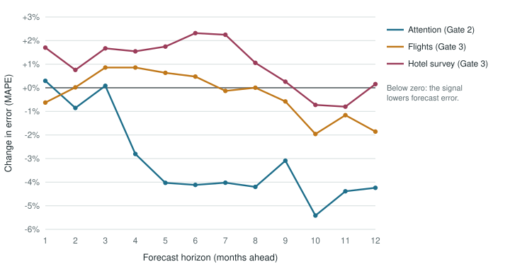
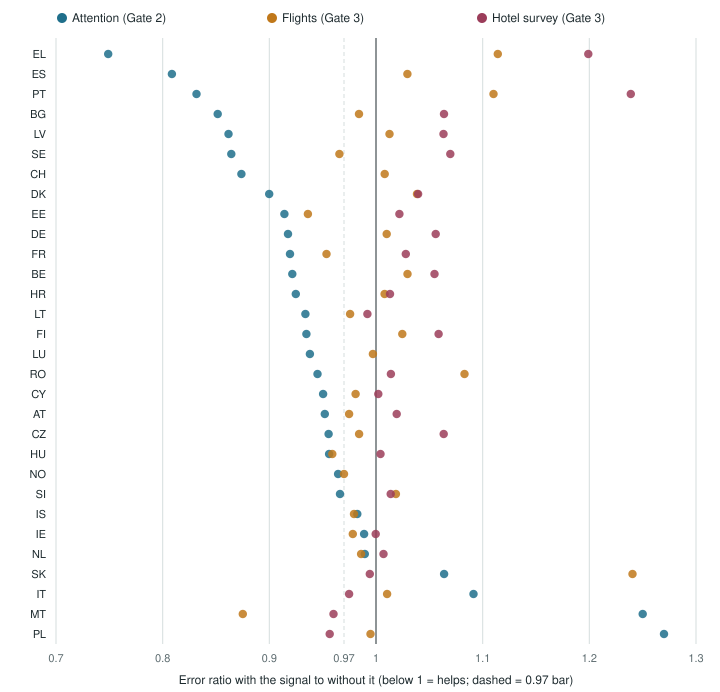

# Attention leads, it does not nowcast: four pre-registered tests of open and early signals for European tourism demand

Ioannis Karydis

Working paper draft, 28 September 2026

> **Author notes before circulation.** (1) Affiliation and contact to add.
> (2) Code and data availability: the analysis code, frozen data snapshots
> and per-forecast error logs sit in the project repository, which is
> private; decide whether to release it with the paper. Until it is
> released, readers cannot check that each pre-registration preceded its
> results (Section 7). The live forecast record is already public
> (Section 6). (3) Journals increasingly ask how AI
> tools were used; the analysis code and this draft were prepared with an AI
> coding assistant, so add a disclosure statement. (4) Reference entries
> marked [check] need their bibliographic details confirmed.

## Abstract

Open, high-frequency signals such as Wikipedia pageviews and news coverage
are widely proposed as early indicators of tourism demand. We test them, and
two early official indicators, against statistical baselines in four
pre-registered backtests of monthly nights spent at tourist accommodation in
30 European countries and 12 Hungarian tourism areas. Each test fixed its
data, models, selection rule and pass criterion in a version-controlled
document before any result was computed, chose its model on a development period, and ran
its holdout (July 2025 to June 2026) once. Three of the four hypotheses
fail. Wikipedia and GDELT news signals do not nowcast the current and next
two months better than a pooled regression on official data alone, at
country level (13 and 15 of 30 countries against a bar of 16) or for
Hungarian areas (5 of 12 against 7). Flight counts published a month after
the month ends, and hoteliers' expected demand from the European
Commission's business survey, do not improve one-to-three-month forecasts
either (16 of 30 countries with a median error ratio of 0.996, and 6 of 25
with 1.019). One hypothesis passes: the same attention signals lower
forecast error four to twelve months ahead, in 26 of 30 countries (median
error ratio 0.936, sign test p = 0.0001). Attention leads demand; it does
not measure it. At short horizons a pooled regression on recent official
growth is hard to beat, and a zero-shot time-series foundation model does
worse than a seasonal ARIMA on COVID-broken series. We report every failed
test in full and describe a public, cryptographically time-stamped record
of the forecasts now being issued.

## 1. Introduction

Official tourism statistics arrive late. Eurostat publishes monthly nights
spent at tourist accommodation two to three months after the month ends,
and regional series later still. Destination managers, hotel groups and
policymakers act before then, and a growing literature proposes to fill the
gap with signals that are free and immediate: search volumes, Wikipedia
pageviews, news coverage, mobility traces. Google Trends improves tourism
demand forecasts over autoregressive baselines across source markets
(Önder, 2017); Wikipedia pageviews have been used to nowcast arrivals
(Tourism and Hospitality, 2026); mobility data can nowcast nights spent (PLOS
ONE, 2023). Reviews find that big data generally improves forecast accuracy
(Wu et al., 2025).

The same reviews, and a recent critical assessment of machine learning in
tourism research (Li et al., 2025), raise a methodological concern. Studies
typically select signals, lags, models and evaluation windows after looking
at the data, and publish when the result is positive. With a dozen
candidate signals, several lags and short monthly series, a spurious
improvement is easy to find and hard to replicate (Gelman and Loken, 2013).
Pre-registration, committing to the analysis before seeing the outcome, is
the standard remedy in other empirical fields (Nosek et al., 2018) and is
rare in tourism forecasting.

This paper reports four pre-registered tests run for a product decision:
whether an open-data "nowcast" of official tourism demand could be sold on
its accuracy. We ask three questions.

1. Do Wikipedia pageviews and GDELT news signals nowcast the current and
   next months better than statistics on official data alone, for countries
   (Gate 1) and for sub-national tourism areas, where the signals are more
   specific (Gate 1b)?
2. Do the same signals improve forecasts one to twelve months ahead
   (Gate 2)?
3. Do early official indicators, flight counts and hoteliers' demand
   expectations, improve short-horizon forecasts where attention did not
   (Gate 3)?

The answers are no, no, yes at four to twelve months, and no. The pattern is
consistent: short horizons belong to official data, and online attention
earns its place only several months ahead, when people are still planning
trips. Section 2 describes the data, Section 3 the protocol and models,
Section 4 the results, Section 5 what they mean, Section 6 the live record,
and Section 7 the limitations.

## 2. Data

**Target.** Nights spent at tourist accommodation (hotels, holiday and other
short-stay accommodation, and campsites; NACE I55.1–I55.3), residents and
non-residents together, from Eurostat dataset `tour_occ_nim`, monthly from
January 2014, for the EU27 plus Iceland, Norway and Switzerland (30
countries). For Hungary's 12 tourism areas, nights from the Hungarian
Central Statistical Office (KSH, table `tur0081`), monthly from January
2021, when the areas were defined. All snapshots were retrieved on 27
September 2026, when national series ran to June or July 2026. We use the
latest vintage throughout.

**Wikipedia.** Monthly user pageviews from the Wikimedia API. For a country,
the sum of its English and German articles and the English article of its
capital; for a Hungarian area, the Hungarian, English and German articles of
its main towns. A month counts only if every listed article reports it.

**GDELT.** From the GDELT daily Global Knowledge Graph files (Leetaru and
Schrodt, 2013). A record counts as tourism coverage if its themes include
TOURISM, WB_825_TOURISM, TAX_FNCACT_TOURIST or TAX_FNCACT_TOURISTS, and
counts for a country if any of its locations carries the country's code. The
tourism share is the number of articles in such records over all articles
that day, summed to months; tone is the article-weighted mean tone. Data
cover January 2017 to February 2020 and January 2022 onward (the months in
between would only feed samples excluded for COVID); Gate 1's first phase
used 2022 onward only. For Hungarian areas,
tourism-tagged counts are almost always zero outside Budapest, so the
regional signal is the share of all records mentioning the area.

**Early official indicators (Gate 3).** EUROCONTROL's airport traffic
dataset: daily IFR arrivals for every reporting airport, January 2016 to
August 2026, summed to months. Because EUROCONTROL's airport list grows
(Italy from 13 airports to 49 in 2024), flight growth is computed over the
airports reporting in both months compared. The European Commission's
services survey for accommodation (NACE 55): the monthly balance of firms
expecting demand to rise over the next three months minus those expecting a
fall, not seasonally adjusted, for 26 countries (none for Luxembourg or the
non-EU countries; Spain's series stops in September 2024). For a
descriptive case study, Spain's international tourist arrivals from the
national border survey (INE FRONTUR), October 2015 to July 2026.

**Timing.** Eurostat's national figures for month *o* appear roughly two to
three months after it ends. By then the following month's attention data are
complete, EUROCONTROL has published the following month's flights (about
four weeks after month end), and the survey has published the following
month (within the month itself). Gates 2 and 3 therefore treat these
signals as known at *o* + 1. Gate 1, a nowcasting study, assumes attention
known through *o* + 3.

## 3. Protocol and models

**Pre-registration.** Each gate's question, data, models, periods, metrics,
selection rule and pass criterion were written into a document committed to
the project's git repository before any model was run on the relevant data.
Amendments made before any affected result (Gate 1: GDELT from the daily
files instead of the throttled API; GDELT from 2022 in phase 1) are recorded
in the same document with their reasons. The commit history is the evidence
of order.

**Periods.** Development targets July 2023 to June 2025; holdout targets
July 2025 to June 2026 (Gate 1b: August 2025 to July 2026). The model to be
tested is chosen on development by a pre-stated rule, the choice is
committed, and the holdout is run once. Gates 1 (phase 2), 2 and 3 reuse
Gate 1's holdout months, so only Gate 1's phase 1 and Gate 1b's holdouts
were fully fresh; Section 7 discusses what this means.

**COVID.** March 2020 to December 2021 are excluded: any training or
evaluation sample whose target, base year or feature months (or their
year-earlier months) fall in that span is dropped. SARIMA sees those months
as missing.

**Models.** All regression models are direct: one regression per horizon
*h*, predicting year-on-year log growth of nights in target month *t* = *o* +
*h* from information known at origin *o*, the last month with an official
figure:

log(*y**t* / *y**t*−12) = α*h* +
β*h* *ḡ**o* + γ′*h* **x**

where *ḡ**o* is the mean year-on-year log growth of nights over
*o*−2 … *o* and **x** holds the signals being tested. The benchmark is
seasonal naive (SN), last year's figure. Table 1 lists the models.

*Table 1. Models.*

| Model | Definition | Gates |
|---|---|---|
| SN | *y**t*−12 | all |
| SNG | *y**t*−12 · exp(*ḡ**o*) | 1, 2 |
| AIRLINE | SARIMA(0,1,1)(0,1,1)12 on log nights, refitted at every origin | 1, 1b, 2 |
| GR | per-country regression on *ḡ**o* alone | 1 |
| POOL_GR | the same regression pooled across countries (or areas) | 1b, 2 |
| GR_W, GR_WG | GR plus Wikipedia growth (W) and GDELT share and tone (G), per country | 1 |
| POOL_W, POOL_WG | the same, pooled | 1, 1b, 2 |
| CHRONOS | Chronos-Bolt (small), zero-shot on log nights (Ansari et al., 2024) | 2 |
| COMBO | mean of AIRLINE, POOL_GR and CHRONOS log forecasts | 2 |
| WG (= POOL_GR_WG) | Gate 2's shipped model, pooled with attention | 3 |
| WG_F, WG_S, WG_FS | WG plus flight growth (F), survey change (S), or both | 3 |

Attention enters as mean year-on-year log growth over three months (tone as
a change); in Gate 3, flight growth and the year-on-year change in the
survey balance enter at the single month *o* + 1. Intervals for the
regressions are the 10% and 90% quantiles of training residuals.

**Scoring.** The mean absolute scaled error (MASE; Hyndman and Koehler, 2006)
uses a fixed per-country scale, the mean absolute seasonal difference over
2016–2019. Any comparison of two models uses only the cells both forecast.
Each gate's primary criterion counts the countries in which a model's MASE is
below a benchmark's, and Gates 2 and 3 add a bar on the median ratio. We
also report Diebold–Mariano tests with the Harvey et al. (1997) correction
where they are informative, and sign tests across countries.

## 4. Results

*Table 2. The four gates.*

| Gate | Question | Criterion (holdout) | Result |
|---|---|---|---|
| 1, countries | Does the selected attention model nowcast *h* = 1–3 with MASE ≤ 0.90 × SN? | ≥ 16 of 30 countries | **Fail**: 13/30 (phase 1), 15/30 (phase 2) |
| 1b, Hungarian areas | The same for 12 KSH tourism areas, *h* = 1–2 | ≥ 7 of 12 | **Fail**: 5/12 |
| 2, skill | Does the best official-data model forecast *h* = 1–12 with MASE ≤ 0.90 × SN? | ≥ 16 of 30 | **Fail**: 5/30 |
| 2, attention | Do Wikipedia and GDELT improve POOL_GR? | ≥ 16 of 30 better, median ratio ≤ 0.97 | **Pass**: 26/30, 0.936 |
| 2, calibration | Do the shipped model's 80% intervals cover 70–90%? | | **Pass**: 81% |
| 3, flights | Does flight growth improve WG at *h* = 1–3? | majority of eligible countries, median ≤ 0.97 | **Fail**: 16/30, 0.996 |
| 3, survey | Does the survey's expected demand improve WG at *h* = 1–3? | the same | **Fail**: 6/25, 1.019 |

### 4.1 Gate 1: attention does not nowcast

With GDELT from 2022 only (phase 1), the selected model POOL_W reached the
10% bar against seasonal naive in 13 of 30 countries (median ratio 0.910).
The official-data regression GR reached it in 15 by itself. Against GR, the
fair comparison, POOL_W was better in 17 countries, significantly so
(Diebold–Mariano, p < 0.10) in 2 and significantly worse in 3.

Phase 2, pre-registered before phase 1's results, restored pre-COVID GDELT
history. The selected POOL_WG reached the bar in 15 of 30 countries, the same
as GR. It beat GR in 20 of 30 with a median error ratio of 0.970, and its
mean absolute percentage error at *h* = 1, 2, 3 was 4.45%, 4.72% and 4.84%,
against GR's 4.51%, 4.77% and 4.96% and seasonal naive's 5.33%. The edge is
consistent but small: about 3% at the median country, a tenth of a
percentage point of error. Most of the gain over last year's figure comes
from the statistical model on official data.

### 4.2 Gate 1b: sharper signals do not help either

The hypothesis that sub-national signals are more specific, and therefore
more useful, fails. POOL_W reached the bar in 5 of 12 Hungarian areas, and no
area showed a significant improvement over seasonal naive. The pooled
official-data regression POOL_GR did better (6 of 12, median 0.913 × SN,
against POOL_W's 0.945), and adding GDELT did not help (0.948). GDELT barely
covers small destinations: the median monthly number of mentions for Eger,
Pécs and Bük-Sárvár is zero.

### 4.3 Gate 2: attention helps several months ahead

At horizons 1–12, the best official-data model on development was COMBO. On
the holdout it cleared the 10% bar against seasonal naive in only 5 of 30
countries, so the skill criterion fails. Adding attention to the pooled
regression, however, lowered error in 26 of 30 countries (median ratio
0.936; 24 of 30 on development, same median). A sign test across countries
gives p = 0.0001; the countries are not independent, so this overstates
certainty. The pre-registered Diebold–Mariano tests are degenerate here: with
12 target months and lag 12, the small-sample correction factor is zero.

The gain is concentrated at four months and beyond (Figure 1): attention
lowers mean absolute percentage error by 3–5% at *h* = 4–12 and by
essentially nothing at *h* = 1–3. The resulting model, POOL_GR_WG, beat
seasonal naive in 20 of 30 countries (4.96% against 5.35% mean absolute
percentage error; median ratio 0.931), with 81% coverage of its 80%
intervals. It cleared the 10% bar in 11 countries.

*Figure 1. Change in mean absolute percentage error from adding each signal,
by horizon, holdout July 2025 to June 2026. Attention (Wikipedia and GDELT):
POOL_GR_WG against POOL_GR (Gate 2). Flights and survey: WG_F and WG_S against WG (Gate 3).
Each comparison uses the cells both models forecast. Data:
`figures/fig1_horizon.csv`.*

The zero-shot foundation model was the weakest component. Chronos-Bolt lost
to SARIMA in 26 of 30 countries (median error ratio 1.44), apparently reading
the COVID collapse and rebound as part of the seasonal pattern. It still
helped the COMBO average on development, but COMBO did worse than seasonal
naive on the holdout (mean MASE 1.032), while the simpler pooled regression
held up.

### 4.4 Gate 3: early official indicators add nothing at short horizons

Gate 3 asked whether two official sources published before Eurostat's
nights fill the short-horizon gap. They do not (Figure 2). Flight growth for
the month after the origin improved the shipped model in 16 of 30 countries,
a coin toss (sign test p = 0.86), with a median ratio of 0.996; on
development it was 13 of 27 and 1.002. The hotel survey made forecasts worse
in 19 of 25 countries (median 1.019, sign test p = 0.015) and in 14 of 22 on
development. Using the survey a month earlier, its usual availability, made
no difference (6 of 25, 1.021). Neither source helped at four to twelve
months.

*Figure 2. Holdout error ratio by country for each signal: attention
(Wikipedia and GDELT; Gate 2, all horizons, against POOL_GR), flights and survey (Gate 3, h = 1–3, against
WG). Dashed line: the 0.97 median bar. Data: `figures/fig2_countries.csv`.*

Two descriptive comparisons, not used for any decision, point the same way.
A regression with flights in place of attention was worse than WG in 20 of
27 countries on development but better in 18 of 30 on the holdout; the
periods disagree, so it supports no claim. And for Spain, adding FRONTUR's
arrivals growth to a Spain-only regression lowered error on development
(ratio 0.968 at *h* ≤ 3) and raised it on the holdout (1.280, on 36 cells
where both models were already within about 2%). The Bank of Greece's and
Banca d'Italia's monthly series could not be retrieved for this study.

## 5. Discussion

**Attention leads.** The one positive result is also the most interpretable.
People read about a destination while they plan, weeks or months before
they travel, so interest carries information about demand several months
out, when the official series has nothing yet to say. Descriptively,
Wikipedia interest led official nights by one to two months in regions such
as Cataluña (correlation 0.59) and Veneto (0.61). By the time the trip is
near, the official series' own recent growth already reflects the same
demand, and attention adds nothing. This reconciles the positive findings of
the search-data literature, which mostly forecast several months ahead,
with our failure to nowcast.

**Short horizons belong to official data.** Across Gates 1, 1b and 3, the
model to beat at one to three months was a regression, pooled across units,
on the average year-on-year growth of the last three official months.
Neither online attention nor earlier official indicators improved on it.
Flights count aircraft rather than passengers, include residents leaving
and cargo, and move with the same momentum the regression already captures.
Hoteliers' expectations are noisy and partly seasonal; their year-on-year
change does not translate into national nights growth. The practical value
of short-horizon forecasting lies in timeliness: an official-data estimate
delivered two to three months before publication is roughly 5–10% more
accurate than last year's figure, which is itself a strong benchmark.

**Pooling matters more than signals.** Where both were tried, pooled
regressions did better than per-unit ones: the pooled attention models were
selected over their per-country versions in both phases of Gate 1, and
per-country GDELT models overfit badly when their training history was
short (72% coverage of nominal 80% intervals in phase 1). With about a hundred clean
monthly observations per country, and COVID removing two years of them,
sharing coefficients across countries is what makes a regression stable.

**Foundation models need care with structural breaks.** The zero-shot
Chronos-Bolt result is a caution rather than a verdict on the model class:
on short, seasonal series broken by an unprecedented collapse, a model
without an explicit break treatment does worse than a thirty-year-old
seasonal ARIMA that is told which months to ignore.

**Negative results are informative.** Three of four hypotheses failed. Had
we selected signals, lags and windows after the fact, a positive nowcasting
result would almost certainly have been available: phase 2 of Gate 1 found
significant improvements over the official-data regression in five
countries. Pre-registration turns these into what they are, a small edge
that does not reach a meaningful bar, and makes the positive Gate 2 result
more credible.

## 6. A public record

A backtest, even a pre-registered one, uses history that the researcher has
seen. The clean test is prospective. Since 27 September 2026 the forecasts
of the model that passed Gate 2 (27 EU countries) and of the unvalidated
nights-only model (NUTS 2 regions) are issued and published in a
public repository, github.com/ikarydi/tourism-pulse-forecasts, as each new
official month is published. Each batch is
a CSV file whose SHA-256 hash carries an RFC 3161 timestamp token from an
independent authority (freetsa.org), so anyone can verify with standard
tools that each forecast existed before Eurostat published the month it
forecasts. Published batches are never edited. The first batch, 3,276
forecasts issued on 27 September 2026, targets July 2026 onward; Eurostat's
latest national month at publication was June 2026. We will compare the live
error with the backtest after six scored months.

## 7. Limitations

- **Pre-registration order is not yet externally verifiable.** Each
  protocol was committed to git before its results, but git dates are set by
  whoever commits and the repository is private. Until the repository is
  released, the order rests on the author's word. The live record (Section 6)
  does not have this weakness: its timestamps come from an outside
  authority.
- **Reused holdout months.** Gates 1 (phase 2), 2 and 3 were scored on the
  months Gate 1 first used. Later gates asked new questions (new horizons, new
  signals), and their models and selections were fixed before the holdout,
  but the researcher knew how some baselines had performed on those months.
  The results that depend least on this are the clear ones: Gate 3's misses
  and Gate 2's attention gain, which held on development with the same
  median ratio. The live record is the unbiased test.
- **One holdout year.** Twelve target months per country is short, which is
  why the Diebold–Mariano tests in Gate 2 were degenerate and why we lean on
  counts across countries.
- **Final data.** All series are the latest vintages, not what was known in
  real time. Revisions to the official series could change the relative
  value of timely sources.
- **Country level.** Only the Hungarian study tests a finer level. Flights
  may matter more for island and airport-dominated regions than for
  countries, but regional monthly nights start in 2020, too short for a
  clean test yet.
- **Declining attention data.** Wikipedia's own traffic has been falling:
  for the median tracked place, monthly views have been 3–22% below the same
  month a year earlier in every month since May 2024. The Gate 2 holdout
  already sits inside this decline, and the pooled model reads differences
  between countries rather than the common fall, but a faster or uneven
  decline could erode the edge.
- **English-language news.** GDELT's daily files are dominated by
  English-language sources, so its coverage and tone describe international
  English-language news.

## 8. Conclusion

Open attention data is a leading indicator of tourism demand, not a
coincident one. It improves forecasts of official nights four to twelve
months ahead and adds nothing to nowcasts, which is also true of flight
counts and hoteliers' expectations. For anyone building on these signals the
lesson is to use them where they lead, to benchmark against a pooled
official-data regression rather than a naive model alone, and to fix the
analysis before looking. The forecasts now being issued are public and
time-stamped, so the claim can be checked against the future rather than
the past.

## References

- Ansari, A. F., et al. (2024). Chronos: Learning the language of time
  series. *Transactions on Machine Learning Research*. [check]
- Gelman, A., and Loken, E. (2013). The garden of forking paths: Why multiple
  comparisons can be a problem, even when there is no "fishing expedition"
  or "p-hacking" and the research hypothesis was posited ahead of time.
  Working paper, Columbia University.
- Harvey, D., Leybourne, S., and Newbold, P. (1997). Testing the equality of
  prediction mean squared errors. *International Journal of Forecasting*,
  13(2), 281–291.
- Hyndman, R. J., and Koehler, A. B. (2006). Another look at measures of
  forecast accuracy. *International Journal of Forecasting*, 22(4),
  679–688.
- Leetaru, K., and Schrodt, P. A. (2013). GDELT: Global data on events,
  location, and tone, 1979–2012. *ISA Annual Convention*.
- Li, Liu and Meng (2025). Machine learning techniques in tourism research:
  a critical assessment. *Journal of Travel Research*.
  https://doi.org/10.1177/00472875251401912 [check]
- Nosek, B. A., Ebersole, C. R., DeHaven, A. C., and Mellor, D. T. (2018).
  The preregistration revolution. *Proceedings of the National Academy of
  Sciences*, 115(11), 2600–2606.
- Önder, I. (2017). Forecasting tourism demand with Google Trends: accuracy
  comparison of countries versus cities. *International Journal of Tourism
  Research*, 19(6), 648–660. https://doi.org/10.1002/jtr.2137 [check]
- *PLOS ONE* (2023). Nowcasting tourist nights spent using human mobility
  data. https://doi.org/10.1371/journal.pone.0287063 [check authors]
- *Tourism and Hospitality* (2026). Open-data nowcasting of international
  arrivals to Ecuador with Wikipedia attention, 7(4), 113.
  https://doi.org/10.3390/tourhosp7040113 [check authors and title]
- Wu, Zhong, Wu and Song (2025). Tourism and hospitality forecasting with big
  data. *Journal of Hospitality and Tourism Research*.
  https://doi.org/10.1177/10963480231223151 [check]

## Appendix: where each number comes from

| Section | Source in the project repository |
|---|---|
| Gate 1 | `research/nowcast/PREREGISTRATION.md`, `results/VERDICT_PHASE1.md`, `VERDICT_PHASE2.md` |
| Gate 1b | `research/nowcast/PREREGISTRATION_REGIONAL.md`, `results/VERDICT_REGIONAL.md` |
| Gate 2 | `research/forecast/PREREGISTRATION.md`, `results/SELECTION.md`, `VERDICT.md` |
| Gate 3 | `research/gate3/PREREGISTRATION.md`, `results/SELECTION.md`, `VERDICT.md`, `national.md` |
| Figures | `research/paper/figures.py`, from the holdout error logs |
